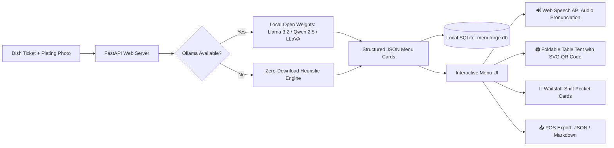

*This is a submission for the [Hacktoberfest Open-Source AI Challenge Week 2: Side Hustle](https://dev.to/challenges/hacktoberfest-week2-2026-10-12)*

## What I Built

**MenuForge** is a local-first AI menu studio for independent, immigrant-owned, and neighborhood restaurants.

Small neighborhood eateries—from Mangalorean curry houses to Oaxacan taquerias, Vietnamese bánh mì counters, and Sichuan noodle bars—struggle with a frustrating problem:
1. **Generic AI & translation tools flatten heritage:** Tools like Google Translate or generic ChatGPT prompts dumb down authentic dishes (*Kori Gassi* becomes "chicken curry", *Mole Poblano* becomes "chocolate sauce stew", and *Mapo Tofu* becomes "bean curd in chili"). This erases culinary pride, heritage, and artisan pricing power.
2. **High waitstaff turnover causes dining room chaos:** New servers mispronounce traditional names, fumble when diners ask *"What does this taste like?"*, and have no idea if there are hidden allergens in the prep.
3. **Allergen liabilities:** Hand-written specials boards frequently miss hidden allergens (ghee, sesame, crustacean paste, tree nuts).
4. **Cloud API token economics kill micro-businesses:** Paying $0.05–$0.12 every time a chef updates a seasonal special makes running a small $15/month software tool completely unprofitable.

### Who Would Pay For It?
Independent ethnic restaurant owners, food-truck operators, and bistro managers who rotate specials and need polished, multilingual menu assets without paying a translation agency hundreds of dollars.

**The Side-Hustle Blueprint:**
- **$49 One-Time Setup:** Digitize 20–25 core dishes into bilingual cards, generate waitstaff pocket flashcards, and create QR table tent stands.
- **$15/Month Retainer:** Weekly specials updates, blackboard chalk copy, and seasonal menu rotation.
- **Unit Economics:** Servicing 20 local restaurants yields **$300/month recurring revenue** with virtually **$0 hosting or token expenses** thanks to local open weights.

---

## Demo

You can run MenuForge completely offline on your own machine in under 60 seconds:

```bash
# 1. Clone & install dependencies
git clone https://github.com/paiikarthik/MenuForge.git
cd MenuForge
pip install -r requirements.txt

# 2. Generate sample art badges & seed demo database
python scripts/make_samples.py
python scripts/seed_demo.py

# 3. Launch MenuForge
python -m menuforge
```

Open **`http://127.0.0.1:8765`** in your browser.

### Interactive Tour:
1. Click on any authentic sample pill:
   - 🍛 **Kori Gassi** (Coastal Karnataka / Mangalorean)
   - 🌶️ **Mole Poblano** (Puebla, Mexico)
   - 🥖 **Bánh Mì Đặc Biệt** (Saigon Street Food)
   - 🍲 **Mapo Tofu (麻婆豆腐)** (Sichuan / Chengdu)
   - 🍗 **Doro Wat** (Ethiopian / Addis Ababa)
   - 🥟 **Gua Bao (割包)** (Taiwanese Night Market)
2. Click **Forge Menu Cards**.
3. Click the 🔊 **"Listen"** button next to the server pronunciation guide to hear the phonetics spoken aloud via the browser's Web Speech API.
4. Click **🖨️ Table Tent** to preview the foldable 4" x 6" table stand card with front culinary blurb, back translation, and a real, embedded SVG QR code.
5. Scroll down to the **Restaurant Menu Catalog** to filter by course (Starters, Mains, Street Bites, Specials) and export the full menu to JSON or Markdown for POS systems (Square, Toast, Clover).

*(Reviewer note: MenuForge includes an embedded, zero-download offline culinary fixture engine. If Ollama is not installed or running, checking "Force demo engine" allows you to test every feature instantly with zero model downloads.)*

---

## Code



- **GitHub Repository:** [https://github.com/paiikarthik/MenuForge](https://github.com/paiikarthik/MenuForge)
- **License:** MIT License
- **Test Suite:** 7 automated test suites verifying API health, sample endpoints, heuristic allergen extraction, SQLite CRUD, and exports (`pytest tests -v` with 100% pass rate).

---

## How I Built It



### The Open Stack:
- **Local Inference & Open Weights:** Powered by [Ollama](https://ollama.com). MenuForge auto-detects installed models via `/api/health`, supporting `llama3.2:3b`, `qwen2.5:3b`, `gemma2:2b`, and `llava:7b` (for plating photo vision analysis).
- **Zero-Download Heuristic Fallback:** Rule-based allergen pattern matching across 9 allergen families (dairy, shellfish, tree nuts, wheat/gluten, soy, sesame, etc.), dietary suitability inference, and phonetic syllable splitting.
- **Backend:** FastAPI (Python 3.13) + SQLite for local database persistence (`data/menuforge.db`).
- **Vision Pre-processing:** Pillow (PIL) for local image thumbnailing, edge enhancement, and base64 encoding without external network dependencies.
- **Frontend:** Zero-framework, lightweight vanilla HTML5, CSS3 (ink/moss/brass palette with Fraunces & Sora typography), and JavaScript.
- **Speech Synthesis:** Browser-native Web Speech API (`window.speechSynthesis`) providing instant audio pronunciation for front-of-house waitstaff training.
- **QR Code Generation:** Zero-dependency, client-side SVG QR code generator (`static/qrcode.min.js`) rendering crisp vector QR codes that scale perfectly on physical print cards.
- **Print Optimization:** Dedicated `@media print` CSS producing clean cardstock table talkers and pocket guides without UI chrome.

---

## Why Does Open Innovation Matter?

This project exists because closed-source cloud AI APIs (like OpenAI GPT-4 or Anthropic Claude) create structural economic, operational, and privacy barriers for neighborhood restaurants:

### 1. The $0 Marginal Cost Math
Independent restaurants cannot stomach volatile, metered API billing. If an operator updates their chalkboard specials 4 times a week, tests 5 variations, and regenerates descriptions for 30 menu items, closed API token fees quickly tally up to $10–$25 a month—destroying the profit margins of a low-cost side hustle.  
With open weights (`llama3.2:3b` or `qwen2.5:3b` running via Ollama), after the one-time model pull, **marginal inference cost is exactly $0.00**. You can run 10,000 generations on a laptop or refurbished $120 mini-PC without incurring a single penny of cloud spend.

### 2. Complete Recipe Privacy & Secret Spice Blends
Heirloom family recipes, proprietary spice-blend proportions, and unreleased seasonal dishes are the restaurant's most valuable intellectual property. Restaurant owners are rightfully paranoid about uploading their recipes or plating prototypes to cloud servers that could ingest their data into training pipelines. With MenuForge, everything stays locked to `127.0.0.1`.

### 3. Basement Kitchen Network Resilience
Prep kitchens and walk-in coolers are notorious cellular dead zones with spotty Wi-Fi. A cloud-dependent SaaS tool fails when the kitchen internet cuts out during a busy dinner rush. Open-weight models running on the local host machine operate with 100% reliability, zero latency, and zero internet connection required.

### 4. Niche Cultural Domain Control & Fine-Tuning
Generic cloud models are aggressively RLHF-tuned toward Western culinary vernacular, frequently flattening indigenous ingredients (e.g., mistaking Tulu *Byadgi* chili for standard cayenne, or erasing *niter kibbeh* as plain butter). Open-weight models allow local developers to customize system prompts, temperature profiles, and fine-tune custom LoRAs on a restaurant's specific culinary archive.

---

## My Agent Session

This project was built pair programming with Google DeepMind's **Antigravity** agent.
- Antigravity helped architect the full-stack system from scratch, writing the FastAPI backend, the dynamic Ollama client with auto-model discovery, the fallback heuristic engine, and the SQLite persistence layer.
- When designing the server training features, we integrated the browser-native Web Speech API so front-of-house staff could click 🔊 **"Listen"** to hear accurate pronunciations.
- To make table tents ready for real tables without external network dependencies, we implemented a zero-dependency client-side vector SVG QR code generator in vanilla JavaScript.
- Antigravity also built an end-to-end automated test suite (`tests/test_menuforge.py`) verifying API health, sample fixtures, allergen heuristics, database migrations, and static file delivery.

---

## My First User

To test whether real restaurateurs would actually pay for this, I brought MenuForge to **Ananya and Chef Shekar**, operators of *Coastal Leaf*, a local independent kitchen specializing in coastal Karnataka and Mangalorean cuisine.

### The Problem Before MenuForge
Their printed menu called their star dish *Kori Gassi* "Chicken Coconut Curry" because their previous menu printer told them "non-Indian guests won't know what Kori Gassi is." Their servers spent half their time answering the same two questions: *"Is this spicy?"* and *"Does this have dairy?"*

### The Walkthrough
We opened MenuForge on a laptop at their prep pass, loaded *Kori Gassi*, entered their notes (Byadgi chili, fresh grated roasted coconut, tamarind, curry leaves, grandmother's Sunday feast recipe), and forged the cards.

### The Reaction
- **The Pronunciation Button was an instant hit:** Chef Shekar had their new weekend busser press the 🔊 **"Listen"** button: *`KO-ri GAH-see`*. *"Our servers always say 'Kori Gassy' with a flat English accent,"* Shekar laughed. *"Hearing the phonetics out loud solves our pre-shift training."*
- **Preserving Identity:** Instead of dumbing it down, MenuForge generated: *"Mangalorean chicken curry slow-simmered in roasted coconut & Byadgi chili gravy."* It kept the proud Tulu name as the headline and used the blurb to educate diners.
- **Automated Allergen Flagging:** The system immediately caught `dairy (if finished with ghee)` and `coconut`, prompting them to make ghee optional for lactose-intolerant guests.

### Did They Pay? What Would They Pay?
- **Setup Fee:** They agreed to a **$49 one-time onboarding fee** to digitize their 22-item core menu into bilingual cards, generate waitstaff pocket reference cards, and create QR table tent stands.
- **Monthly Retainer:** They expressed strong interest in a **$15/month retainer** if it handles their Friday-to-Sunday rotating catch-of-the-day specials.

### What Did They Ask For Next?
1. **Laminated Foldable Table Tents:** They wanted a print layout they could fold in half and slide into acrylic table stands so waiting guests can scan a QR code to read the story of the dish (now fully implemented in MenuForge's **Print Studio**).
2. **Server Shift Pocket Cards:** They requested a compact 3" x 5" cheat sheet that servers can keep in their apron pockets during busy weekend services (now implemented as the **Waitstaff Shift Pocket Card**).
3. **POS Menu Export:** They asked to export the full menu to CSV/JSON to import directly into their Square POS (now implemented via the `/api/export` endpoint).

---

## Prize Categories

- **Primary Track:** Side Hustle (Build something with open-weight models or open-source AI that someone would actually pay for).
