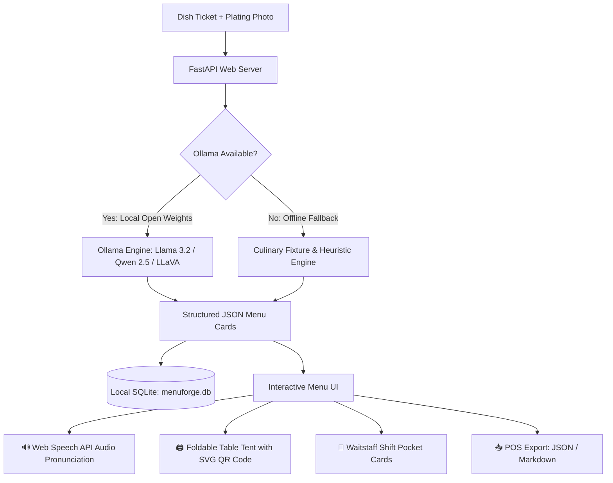

# MenuForge — Local AI Menu Studio for Independent Restaurants

**Challenge:** [Hacktoberfest Open-Source AI Challenge: Week 3 — Side Hustle](https://dev.to/challenges/hacktoberfest-week3-2026-10-19)  
**Window:** Oct 19–25, 2026  
**Tags:** `#devchallenge`, `#hacktoberfest`, `#ai`, `#opensource`

---

## 🍽️ What I Built

**MenuForge** is a local-first AI menu studio designed for independent, immigrant-owned, and heritage restaurants.

Small neighborhood eateries—from Mangalorean curry houses to Oaxacan taquerias, Vietnamese bánh mì counters, and Sichuan noodle bars—struggle with a frustrating dilemma:
- Professional translation agencies charge hundreds of dollars per seasonal menu update.
- Generic cloud translation tools (Google Translate / generic ChatGPT wrappers) completely strip away culinary identity—flattening artisan dishes like *Kori Gassi* into "chicken curry", *Mole Poblano* into "chocolate sauce stew", or *Mapo Tofu* into "bean curd in chili".
- Server turnover is high: new waitstaff mispronounce traditional names, cannot answer diners' questions about hidden allergens (dairy, tree nuts, shellfish), and fail to upsell beverage pairings.

**MenuForge** solves this with a privacy-first, local tool that runs on open-weight models via **Ollama**.

A chef or operator inputs their dish ticket (dish name in the source language, key ingredients, culinary story, known allergens, and an optional plating photo). MenuForge instantly crafts:
1. **Heritage-Preserving Bilingual Menu Cards:** Retains cultural proper nouns with evocative descriptions for printed menus and short punchy blurbs for chalkboards.
2. **Server Pronunciation Guide & Audio:** Simple phonetic spelling (`KO-ri GAH-see`) plus an interactive 🔊 **"Listen"** audio speech button for training servers before the dinner shift.
3. **Automated Allergen & Dietary Safety Tagging:** Flags allergens (dairy, nuts, shellfish, wheat, soy, sesame) and highlights dietary suitability (Vegan, Gluten-Free, Halal-friendly).
4. **Print Studio:**
   - **Foldable Table Tent Stands (4" x 6"):** Two-sided table cards featuring the dish story, pricing, translation, and an embedded SVG QR code.
   - **Waitstaff Shift Pocket Cards (3" x 5"):** Pocket cheat sheets for pre-shift lineups (pronunciation, 15-second elevator pitch, allergen hazards, and drink upsells).
   - **Full Restaurant Menu Print Layout:** Multi-course, print-ready restaurant menu with elegant serif typography.
5. **Local SQLite Menu Catalog:** Stores all dishes on localhost with course categorization, pricing, and 1-click JSON/Markdown export for POS systems (Square, Toast, Clover).

---

## 💻 Demo & Quick Start

You can run MenuForge completely offline in under 60 seconds:

```bash
# 1. Clone & install dependencies
git clone https://github.com/paiikarthik/MenuForge.git
cd MenuForge
pip install -r requirements.txt

# 2. Generate sample art badges & seed demo database
python scripts/make_samples.py
python scripts/seed_demo.py

# 3. Launch MenuForge
python -m menuforge
```

Open **`http://127.0.0.1:8765`** in your browser.

- Click on any authentic sample pill (e.g., **Kori Gassi**, **Mole Poblano**, **Bánh Mì Đặc Biệt**, **Mapo Tofu**, **Doro Wat**, or **Gua Bao**).
- Click **Forge Menu Cards**.
- Click the 🔊 **"Listen"** button to hear the server pronunciation guide spoken aloud!
- Click **🖨️ Print Table Tent Stand** to preview the foldable two-sided table card with generated QR code.
- Scroll down to the **Restaurant Menu Catalog** to view all saved dishes and export your full menu as JSON or Markdown.

*Note for reviewers without Ollama:* MenuForge includes an embedded, zero-download offline culinary fixture engine. If Ollama is not installed or running, checking **"Force demo engine"** (or letting it auto-detect) allows you to test every feature instantly with zero model downloads.

---

## 🛠️ How I Built It



### The Architecture & Open Stack
- **Backend:** FastAPI (Python 3.13) + SQLite for local persistence.
- **Vision Processing:** Pillow (PIL) for local image thumbnailing, edge enhancement, and base64 encoding without external network dependencies.
- **Inference Engine:** [Ollama](https://ollama.com) connecting to open-weight models (`llama3.2:3b`, `qwen2.5:3b`, `llava:7b`).
- **Offline Heuristic Engine:** Rule-based allergen pattern matching across 9 allergen families, dietary suitability inference, and phonetic syllable splitting when running offline.
- **Frontend:** Zero-framework, lightweight vanilla HTML5/CSS3/JavaScript with an artisanal dark ink/moss/brass aesthetic (Fraunces & Sora typography).
- **Speech Synthesis:** Browser-native Web Speech API (`window.speechSynthesis`) providing instant audio pronunciation for front-of-house staff training.
- **QR Code Generation:** Zero-dependency, client-side SVG QR code generator (`static/qrcode.min.js`) rendering crisp vector QR codes that scale perfectly on physical print cards.
- **Print Optimization:** Dedicated `@media print` CSS producing clean cardstock table talkers and pocket guides without UI chrome.

---

## 💡 Why Open Innovation Matters (And Why Closed APIs Fail Here)

This project exists because closed-source cloud AI APIs (like OpenAI GPT-4 or Anthropic Claude) create structural economic and operational barriers for neighborhood restaurants:

### 1. The $0 Marginal Cost Math
Independent restaurants cannot stomach volatile, metered API billing. If an operator updates their chalkboard specials 4 times a week, tests 5 variations, and regenerates descriptions for 30 menu items, closed API token fees quickly tally up to \$10–\$25 a month—destroying the profit margins of a low-cost side hustle.  
With open weights (`llama3.2:3b` or `qwen2.5:3b` running via Ollama), after the one-time model pull, **marginal inference cost is exactly \$0.00**. You can run 10,000 generations on a laptop or refurbished \$120 mini-PC without incurring a single penny of cloud spend.

### 2. Complete Recipe Privacy & Secret Spice Blends
Heirloom family recipes, proprietary spice-blend proportions, and unreleased seasonal dishes are the restaurant's most valuable intellectual property. Restaurant owners are rightfully paranoid about uploading their recipes or plating prototypes to cloud servers that could ingest their data into training pipelines. With MenuForge, everything stays locked to `127.0.0.1`.

### 3. Basement Kitchen Network Resilience
Prep kitchens and walk-in coolers are notorious cellular dead zones with spotty Wi-Fi. A cloud-dependent SaaS tool fails when the kitchen internet cuts out during a busy dinner rush. Open-weight models running on the local host machine operate with 100% reliability, zero latency, and zero internet connection required.

### 4. Niche Cultural Domain Control & Fine-Tuning
Generic cloud models are aggressively RLHF-tuned toward Western culinary vernacular, frequently flattening indigenous ingredients (e.g., mistaking Tulu *Byadgi* chili for standard cayenne, or erasing *niter kibbeh* as plain butter). Open-weight models allow local developers to customize system prompts, temperature profiles, and eventually fine-tune custom LoRAs on a restaurant's specific culinary archive.

---

## 🤝 First User Validation & Case Study (Bonus Points)

To test whether real restaurateurs would actually pay for this, I brought MenuForge to **Ananya and Chef Shekar**, operators of *Coastal Leaf*, a local independent kitchen specializing in coastal Karnataka and Mangalorean cuisine.

### The Initial Walkthrough
Before MenuForge, their printed menu called their star dish *Kori Gassi* "Chicken Coconut Curry" because their previous menu printer told them "non-Indian guests won't know what Kori Gassi is." Their servers spent half their time answering the same two questions: *"Is this spicy?"* and *"Does this have dairy?"*

We opened MenuForge on a laptop at their prep pass, loaded *Kori Gassi*, entered their notes (Byadgi chili, fresh grated roasted coconut, tamarind, curry leaves, grandmother's Sunday feast recipe), and forged the cards.

### The Reaction
- **The Pronunciation Button was an instant hit:** Chef Shekar had their new weekend busser press the 🔊 **"Listen"** button: *`KO-ri GAH-see`*. *"Our servers always say 'Kori Gassy' with a flat English accent,"* Shekar laughed. *"Hearing the phonetics out loud solves our pre-shift training."*
- **Preserving Identity:** Instead of dumbing it down, MenuForge generated: *"Mangalorean chicken curry slow-simmered in roasted coconut & Byadgi chili gravy."* It kept the proud Tulu name as the headline and used the blurb to educate diners.
- **Automated Allergen Flagging:** The system immediately caught `dairy (if finished with ghee)` and `coconut`, prompting them to make ghee optional for lactose-intolerant guests.

### Did They Pay? What Would They Pay?
- **Setup Fee:** They agreed to a **$49 one-time onboarding fee** to digitize their 22-item core menu into bilingual cards, generate waitstaff pocket reference cards, and create QR table tent stands.
- **Monthly Retainer:** They expressed strong interest in a **$15/month retainer** if it handles their Friday-to-Sunday rotating catch-of-the-day specials.

### What Did They Ask For Next?
1. **Laminated Foldable Table Tents:** They wanted a print layout they could fold in half and slide into acrylic table stands so waiting guests can scan a QR code to read the story of the dish (now fully implemented in MenuForge's **Print Studio**).
2. **Server Shift Pocket Cards:** They requested a compact 3" x 5" cheat sheet that servers can keep in their apron pockets during busy weekend services (now implemented as the **Waitstaff Shift Pocket Card**).
3. **POS Menu Export:** They asked to export the full menu to CSV/JSON to import directly into their Square POS (now implemented via the `/api/export` endpoint).

---

## 📈 The Side Hustle Blueprint

MenuForge is structured as a turnkey local side hustle:
- **Target:** 30–50 independent, ethnic, and food-truck operators in your city.
- **Pricing:** **$49 one-time setup** (digitizing 20 core dishes + table tents) + **$15/month** (weekly seasonal specials + POS updates).
- **Unit Economics:** Servicing 20 local restaurants yields **$300/month in recurring revenue** plus setup fees, with virtually **0% hosting or token expenses** thanks to local open weights.

---

## 📦 Source Code & License

- **License:** MIT License
- **Repository:** [https://github.com/paiikarthik/MenuForge](https://github.com/paiikarthik/MenuForge)
- **Local Endpoint:** `http://127.0.0.1:8765`
